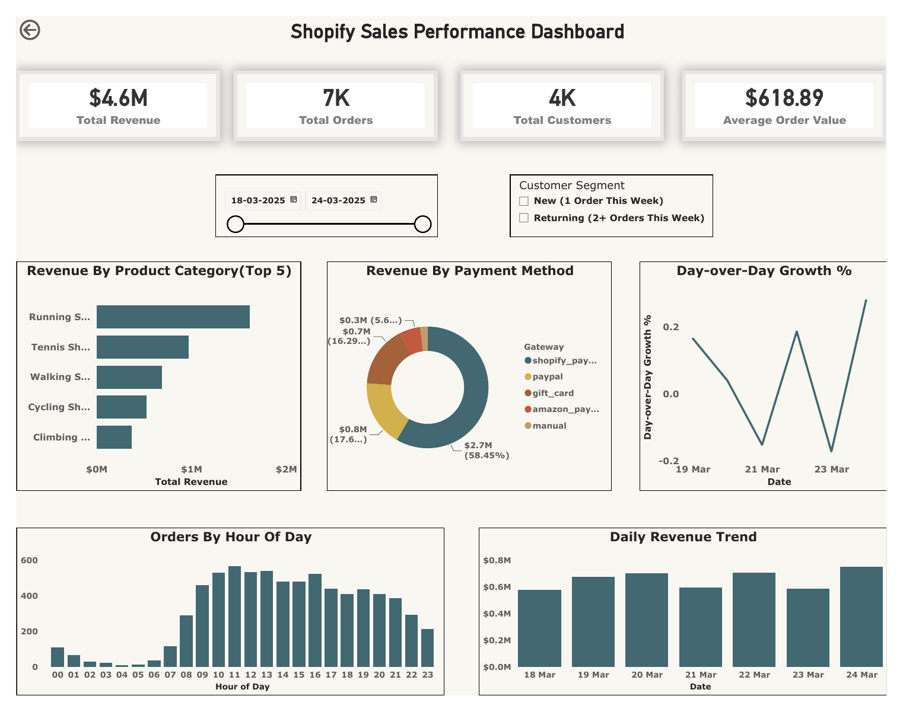
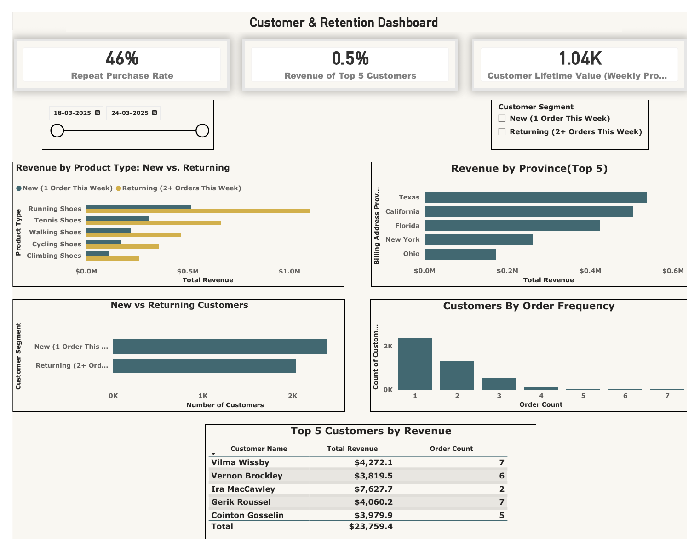

# Shopify Sales Analysis — Power BI Dashboard

A two-page interactive Power BI dashboard that analyses one week of Shopify sales: revenue, customer buying behaviour and customer retention.

Project 1 of 8 · Built during my Data Analyst Internship at Labmentix (Aug–Nov 2026).




## The business question

The store has sales data, but it doesn't know which products earn the most, who its valuable customers are, or whether customers come back.

**Goal:** give a non-technical store owner one dashboard that shows what's working and where to focus: which products to push, when to run promotions, and whether to spend on new customers or on keeping existing ones.

## Key results

| KPI | Value |
|---|---|
| Total revenue | **$4.60M** |
| Total orders | **7,431** |
| Average order value | **$618.89** |
| Unique customers | **4,431** |
| Repeat purchase rate | **46.0%** |
| Customer lifetime value (weekly proxy) | **$1.04K** |

## Key findings

- **Running Shoes lead.** They bring in **$1.62M**, about 35% of revenue. Tennis Shoes ($0.97M) and Walking Shoes ($0.69M) follow.
- **Daytime sells.** Orders peak at **11:00**, and 91.5% of orders come between 08:00 and 22:00. Very few come overnight.
- **Nearly half come back within the week.** 2,039 of 4,431 customers ordered at least twice. But most repeat buyers stop at two orders.
- **The best customers are repeat buyers.** All of the top 5 customers by revenue ordered more than once.
- **Revenue is not concentrated.** The top 5 customers bring in only about 0.5% of revenue, so the store doesn't depend on a few big spenders.
- **Shopify Payments dominates.** It handles 58.5% of revenue, followed by PayPal (17.6%) and gift cards (16.3%).
- **Top regions:** California, Texas and Florida.

## Recommendations

1. **Focus on retention.** Use loyalty rewards and follow-up offers, because the top customers are repeat buyers.
2. **Turn 2-order customers into 3-order customers.** Send a discount or reminder after the second purchase.
3. **Time promotions and support** for the 08:00–22:00 window, especially around midday.
4. **Keep Running Shoes well stocked**, and review whether small categories are worth keeping.

## How it works

1. **Clean the data in Power Query** (7,431 order rows, 19 columns, 18–24 March 2025):
   - Changed Invoice Date from text to a real date and time.
   - Restored lost leading zeros in zip codes (for example "2134" back to "02134").
   - Replaced 11 blank Product Ids with −1 instead of deleting them, so no revenue was lost.
   - Fixed city name capitals, and added Hour and Date helper columns.
2. **Build a star schema.** A star schema is a model with one central table of transactions linked to smaller lookup tables:
   - `Fact_Sales`: one row per order
   - `Dim_Customer`, `Dim_Product` and `Dim_Date` (a calendar table marked as the date table)
   - Surrogate keys (new ID numbers) built with an Index column
3. **Write DAX measures.** DAX is Power BI's formula language. For example:

```DAX
Total Revenue        = SUM(Fact_Sales[Total Price Usd])
Total Orders         = DISTINCTCOUNT(Fact_Sales[Order Number])
Average Order Value  = DIVIDE([Total Revenue], [Total Orders])
Repeat Purchase Rate = DIVIDE([Customers with 2+ Orders], [Total Customers])
Day-over-Day Growth % = DIVIDE([Total Revenue] - [Revenue Prior Day], [Revenue Prior Day])
```

4. **Design two pages** that read top to bottom (KPI cards, then slicers, then detail charts), with synced Date and Customer Segment slicers:

| Page | Charts |
|---|---|
| **1. Sales Performance** | Revenue by product category, revenue by payment method, day-over-day growth, orders by hour, daily revenue trend |
| **2. Customer & Retention** | New vs returning customers, customers by order frequency, revenue by province, top 5 customers, product preference of new vs returning customers |



## Limitations

- **Only one week of data.** So there are no monthly or seasonal trends, and no true cohort analysis.
- **"New" and "Returning" are within this week only.** "New" means one order this week, not a first-ever customer.
- **CLV is a weekly proxy.** It shows the method (AOV × orders per customer), not a real lifetime value.
- **Product Id is not reliable.** 88 of 202 Product Ids map to more than one product type. So product type sits directly on the fact table instead of going through `Dim_Product`. I recorded this as a data-quality finding instead of hiding it.
- **Sample data.** The dataset was provided for the internship and appears to be a generated sample, not a real store's records.

## Open it yourself

1. Download [`dashboard/Shopify_Sales_Analysis.pbix`](dashboard/Shopify_Sales_Analysis.pbix).
2. Open it in **Power BI Desktop** (free, Windows only).
3. No Power BI? See the [dashboard export (PDF)](docs/Dashboard_Export.pdf).

## Project files

| File | What it is |
|---|---|
| `dashboard/Shopify_Sales_Analysis.pbix` | The Power BI dashboard |
| `data/shopify_sales.xlsx` | Raw Shopify sales export (7,431 rows) |
| `docs/Executive_Summary.pdf` | Written report: every stage, DAX measure and insight ([Word version](docs/Executive_Summary.docx)) |
| `docs/Dashboard_Export.pdf` | Both dashboard pages as a PDF |
| `docs/dashboard_page1.png`, `docs/dashboard_page2.png` | Dashboard screenshots |

## How I built it

This was my first Power BI project. I used AI as a guide while learning Power BI. I built the model and dashboard, checked every figure against the data, and wrote the findings.

## Author

**Vipsa Patel** — Data Analyst Intern, Labmentix · [LinkedIn](https://www.linkedin.com/in/vipsapatel)
